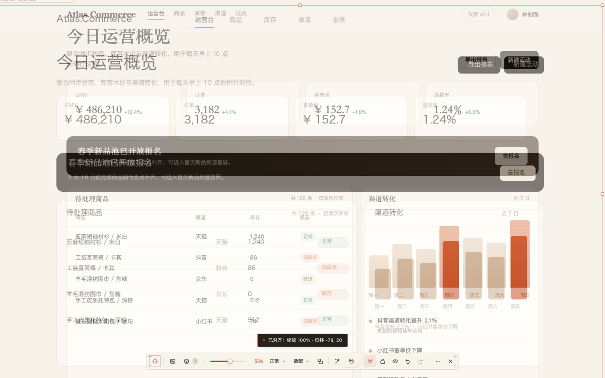
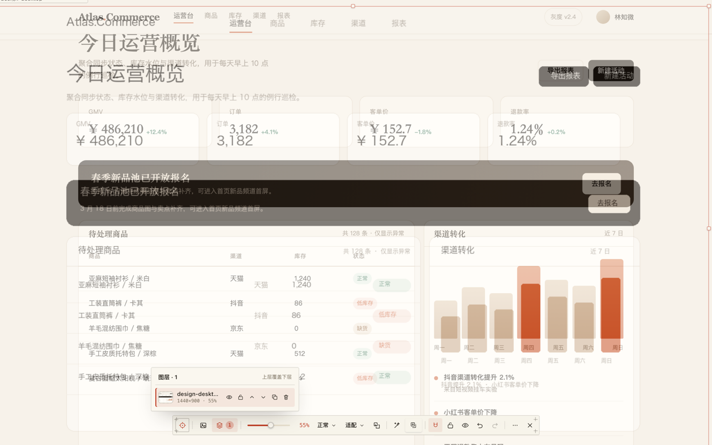
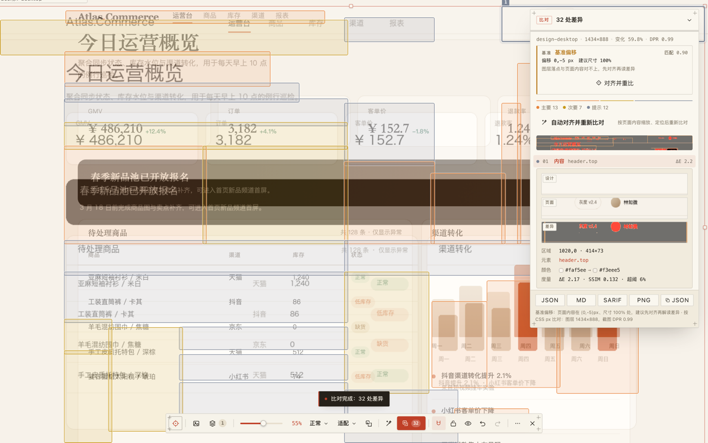
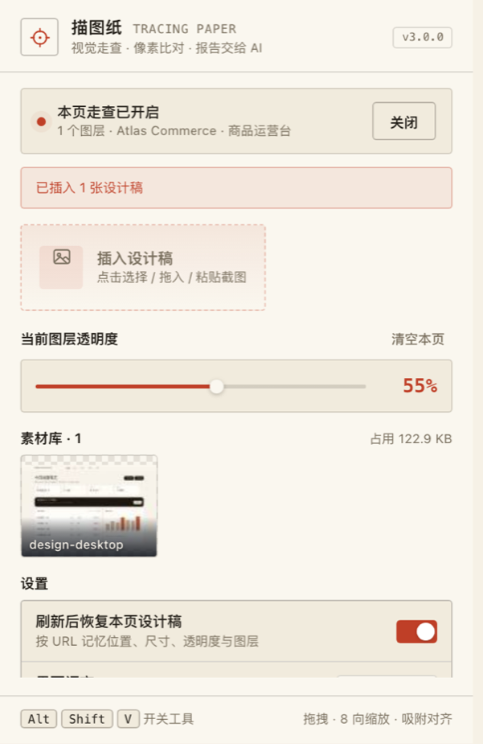
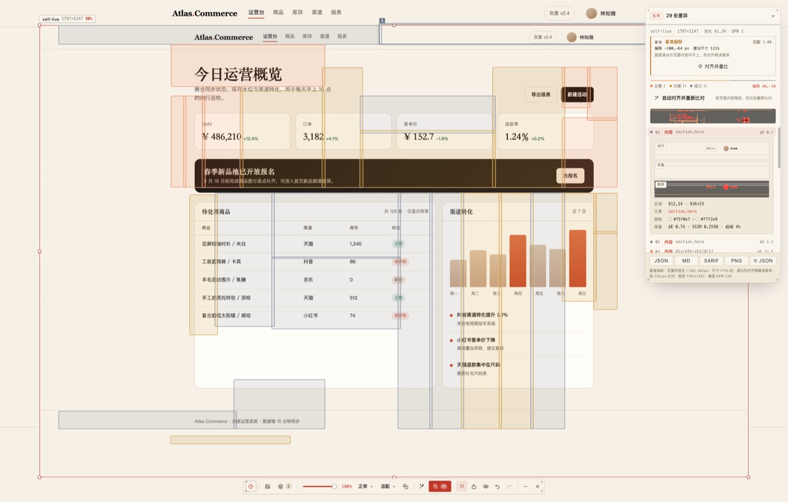
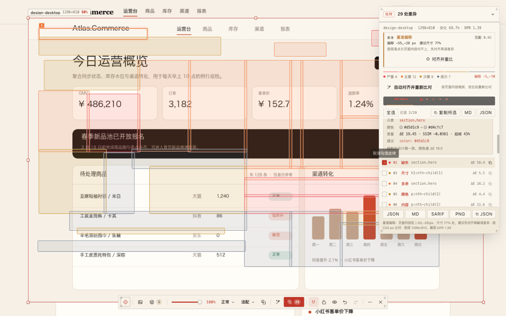

# Tracing Paper · 描图纸

[](LICENSE)
[](public/manifest.json)
[](public/manifest.json)
[](scripts/manifest.mjs)

[中文文档](README.zh-CN.md)

**Put a design mockup on top of a live web page like a sheet of tracing paper — drag, scale and blend it, run a pixel diff, and export a report that an AI agent or a CI job can read.**

Most overlay tools stop at "here is a half-transparent PNG, squint at it". Tracing Paper closes the loop: the visual check becomes structured data. Pixels are measured with ΔE2000 and SSIM, differences are classified, attributed back to DOM elements, and written out as JSON, Markdown and SARIF. The exact same comparison pipeline runs inside the browser extension and in a zero-dependency Node CLI, so a designer, an AI coding agent and a CI job look at the same numbers.

Runs on Chrome / Edge 110+ and Firefox 115+ from one codebase; the same engine also powers a headless CLI.

```
design mockup ─┐
               ├─▶ overlay ─▶ capture ─▶ align ─▶ ΔE / SSIM tiles ─▶ classify ─▶ report.json / .md / .sarif
live page ─────┘
```

---

## Table of contents

- [Tracing Paper · 描图纸](#tracing-paper--描图纸)
  - [Table of contents](#table-of-contents)
  - [Screenshots](#screenshots)
  - [Features](#features)
    - [Overlay and inspect](#overlay-and-inspect)
    - [Auto-fit](#auto-fit)
    - [Diff engine](#diff-engine)
    - [Baseline self-check](#baseline-self-check)
    - [Reports](#reports)
    - [CLI](#cli)
  - [Install the extension](#install-the-extension)
  - [Quick start](#quick-start)
  - [Keyboard shortcuts](#keyboard-shortcuts)
  - [CLI](#cli-1)
    - [Options](#options)
    - [Artifacts](#artifacts)
    - [In CI](#in-ci)
    - [Working with AI agents](#working-with-ai-agents)
  - [Report format](#report-format)
  - [How it works](#how-it-works)
  - [Project layout](#project-layout)
  - [Development](#development)
  - [Privacy and permissions](#privacy-and-permissions)
  - [Limitations](#limitations)
  - [Contributing](#contributing)
  - [License](#license)

## Screenshots

| Overlay · 55% opacity | Layer stack |
| --- | --- |
| <br><sub>Any mockup on any page: drag, scale, snap, blend — auto-fitted here.</sub> | <br><sub>Per-layer opacity, blend mode, lock, visibility and order.</sub> |



<sub>Diff: changed regions drawn on the page, findings with ΔE / SSIM, the matched DOM selector and a suggested fix.</sub>

<p align="center">
  
</p>

<p align="center"><sub>Popup: current scene, asset library and per-URL restore. Screenshots come from the demo page in `.e2e/site`; the UI follows the browser language.</sub></p>

## Features

### Overlay and inspect

- **Layers** — add any number of mockups, each with its own position, size, opacity, blend mode, visibility and lock state.
- **16 blend modes** — `normal`, `difference`, `multiply`, `screen`, `overlay`, `darken`, `lighten`, `color-dodge`, `color-burn`, `hard-light`, `soft-light`, `exclusion`, `hue`, `saturation`, `color`, `luminosity`.
- **Snapping guides** — align layers to each other and to the viewport, toggle with `S`.
- **Freeze** — `F` makes every layer click-through so you can use the page underneath while the mockup stays visible.
- **Undo / redo, duplicate, hide, lock, reorder** — plus a flash-compare animation that blinks the layer twice for a quick eyeball check.
- **Asset library** — uploaded images are cached in `chrome.storage.local` (24 by default) and can be re-inserted from the popup.
- **Per-URL scenes** — layer geometry is saved automatically and restored when you come back to the same page (up to 12 pages).
- **Shadow-DOM UI** — the overlay lives in a `<tracing-paper-root>` custom element, so page CSS cannot break the toolbar and the toolbar cannot leak styles into the page.

### Auto-fit

Press `A` (or the wand button) and Tracing Paper locates the mockup inside the current page: it captures the viewport, converts both sides into a blurred luminance field, samples the design on a gradient-weighted grid, scans plausible scales, and searches the offset in three levels (page → local → pixel). Scoring uses ZNCC, which is immune to global color casts. When two candidates score almost the same, the more "natural" scale (1:1 or viewport-width) wins. It also retries from other scroll positions so sticky headers do not fool the match.

### Diff engine

- Global alignment — an 8/2/1 pyramid shift search; a shift is only applied when it actually lowers the residual.
- One ΔE2000 field per run — the same numbers are used for tile verdicts, region stats and the diff image, so the report never disagrees with itself.
- Tile grid plus local SSIM — 16 px tiles by default, 8-connected clustering into regions, then pixel-level refinement.
- Mask regions — ignore clocks, carousels, ads: `x,y,w,h[:reason]`.
- Finding classification — `shift`, `color`, `size`, `missing`, `extra`, `content`, each with a severity (`blocker` / `major` / `minor` / `info`), measured metrics and (when possible) a suggested CSS fix.
- **Crops** — each finding region exported as a design / page / diff PNG triplet; the extension keeps up to 8.

### Baseline self-check

Before reporting anything, the extension checks whether the layer is actually sitting on the page content. Using the same placement algorithm it computes a match score (ZNCC) and a peak margin, and returns a verdict:

- `ok` — layer is aligned, numbers are trustworthy;
- `drift` — the page content is more than 2 px or 1% scale away; the report carries the suggested rect and one click realigns and reruns;
- `weak` — no confident match, treat the diff as inconclusive.



### Reports

Export from the diff panel as **JSON**, **Markdown**, **SARIF** or **PNG**, or copy the JSON to the clipboard. Tick any finding to copy it on its own, copy the whole selection, or export just the picked subset — numbering stays aligned with the full report. Every artifact is self-describing, stable and diffable.



### CLI

`dist-cli/tracing-diff.mjs` is a single-file Node ESM program with **no dependencies** (PNG decoding/encoding is implemented on top of `node:zlib`). It takes two PNGs plus optional metadata and produces the same report the extension does — ideal for CI, for regression scripts, or for agents that cannot open a browser.

## Install the extension

Requirements: Chrome / Edge 110+ or Firefox 115+, Node.js 18+ for building.

```bash
git clone https://github.com/bestv2/tracing-paper.git
cd tracing-paper
npm install
npm run build
```

`npm run build` produces:

| Output | What it is |
| --- | --- |
| `dist/` | Unpacked extension for Chrome / Edge (`manifest.json`, `popup.html`, `background.js`, `content.js`, `overlay.js`) |
| `dist-firefox/` | Unpacked extension for Firefox (classic event page instead of a service worker) |
| `dist-cli/tracing-diff.mjs` | The standalone diff CLI |

Only need one browser? `npm run build:chrome` or `npm run build:firefox`.

**Chrome / Edge**

1. Open `chrome://extensions`.
2. Enable **Developer mode**.
3. Click **Load unpacked** and select the `dist/` folder.
4. Pin the extension — while the inspector is active on a tab, the action badge shows `ON`.

**Firefox**

1. Open `about:debugging#/runtime/this-firefox`.
2. Click **Load Temporary Add-on…** and pick `dist-firefox/manifest.json`. For a permanent install, run `npm run release` and upload the Firefox zip to AMO.
3. Open the popup and click **Enable**. Firefox treats host access as optional, so allow website access in the prompt the first time.

> `npm run dev` starts a watch build for both targets. Rebuilds are not hot-reloaded into the browser: reload the extension and refresh the page.

## Quick start

1. Open any `http(s)` page and click the toolbar icon, or press `Alt`+`Shift`+`V`. On Firefox, allow website access when the extension asks for it.
2. Add a mockup: upload from the popup, drag an image onto the page, or paste with `⌘/Ctrl`+`V`.
3. Position it: drag to move, `Alt`+wheel to scale, `Alt`+`4` to fill the viewport width, or `A` to auto-fit it onto the page content.
4. Press `D` to diff. Findings are drawn as markers on the page; the panel lists severity, region, ΔE, SSIM, the matched DOM selector and a suggestion.
5. Export `report.json`, `report.md`, `report.sarif` or the diff image.

## Keyboard shortcuts

| Key | Action |
| --- | --- |
| `Alt`+`Shift`+`V` | Open / collapse the toolbar (browser-level command) |
| `⌘/Ctrl`+`V` | Paste an image from the clipboard |
| drag & drop | Drop image files onto the page |
| Arrows / `Shift`+Arrows | Move the selected layer by 1 px / 10 px |
| `[` `]` | Opacity −/+ 5% |
| `0`–`9` | `0` = 100%, `1`–`9` = 10%–90% (two digits in quick succession for an exact value) |
| `H` / `L` | Hide/show · lock/unlock the selected layer |
| `F` | Freeze / thaw all layers |
| `S` | Toggle snapping guides |
| `D` | Run the pixel diff |
| `A` | Auto-fit the selected layer |
| `⌘/Ctrl`+`Z` / `⇧`+`⌘/Ctrl`+`Z` | Undo / redo |
| `⌘/Ctrl`+`D` | Duplicate the selected layer |
| `Delete` / `Backspace` | Remove the selected layer |
| `Alt`+`1` / `2` / `3` | Natural size / 2× / 0.5× |
| `Alt`+`4` | Fit viewport width |
| `Alt`+`5` | Center in viewport |
| `Alt`+`0` | Reset |
| `Alt`+wheel | Scale around the layer center |
| `Esc` | Close the open panel, then deselect |
| `Shift`+`F` | Collapse / expand the toolbar |
| `?` | Shortcut cheatsheet |

## CLI

Build once, then run the generated file with plain Node — no install step, no runtime dependencies:

```bash
npm run build          # or: npm run build:cli

node dist-cli/tracing-diff.mjs \
  --expected design/home@2x.png \
  --actual shots/home.png \
  --out .tracing-report \
  --stdout md
```

`npm run diff -- <args>` is a shortcut for the same command.

### Options

| Flag | Default | Description |
| --- | --- | --- |
| `--expected <file.png>` | required | Design mockup |
| `--actual <file.png>` | required | Page screenshot (same size works best) |
| `--out <dir>` | `.tracing-report` | Artifact directory |
| `--format <list>` | `json,md,sarif,png,crops` | Comma-separated outputs |
| `--tile <n>` | `16` | Grid size in pixels |
| `--delta-e <n>` | `2.3` | ΔE2000 threshold (JND ≈ 2.3) |
| `--ssim <n>` | `0.98` | Minimum structural similarity |
| `--pixel <n>` | `6` | Per-pixel ΔE threshold |
| `--min-area <n>` | `96` | Regions smaller than this (px²) are dropped |
| `--shift-search <n>` | `4` | Local shift search radius |
| `--max-findings <n>` | `120` | Maximum reported findings |
| `--mask <x,y,w,h[:reason]>` | — | Ignore a region; repeatable |
| `--align <auto\|off\|dx,dy>` | `auto` | Global alignment; auto only applies a shift that really lowers the residual |
| `--scale <n>` | `1` | Render scale of the mockup |
| `--url <url>` | — | Page URL recorded in the report |
| `--figma <file.json>` | — | Figma node export (REST or plugin) for the semantic layer |
| `--dom <file.json>` | — | Page layout export for the semantic layer |
| `--baseline <report.json>` | — | Compare with a previous report and write a unified diff |
| `--stdout <json\|sarif\|md\|diff>` | — | Print only the compact result to stdout |
| `--exit-code` | off | Exit with `1` when there are findings |
| `--quiet` | off | Do not print the summary |
| `--help` | — | Usage |

Exit codes: `0` success, `1` findings with `--exit-code`, `2` bad arguments or I/O failure.

### Artifacts

```
.tracing-report/
├── report.json     # machine-readable contract (schemaVersion: tracing.diff/2)
├── report.md       # human summary with a findings table, ready to paste into a chat
├── report.sarif    # SARIF 2.1.0, ruleId = vi/<kind>
├── report.diff     # only with --baseline: unified diff of findings (+ new, - fixed)
├── layout.diff     # only with --figma + --dom: unified diff of the semantic layer
├── diff.png        # highlighted difference image
└── crops/
    ├── c1.expected.png
    ├── c1.actual.png
    └── c1.diff.png
```

### In CI

```yaml
name: visual-check
on: [pull_request]

jobs:
  diff:
    runs-on: ubuntu-latest
    steps:
      - uses: actions/checkout@v4
      - uses: actions/setup-node@v4
        with:
          node-version: 20
      - run: npm ci && npm run build:cli
      - name: Screenshot your app, then diff
        run: |
          node dist-cli/tracing-diff.mjs \
            --expected design/home.png \
            --actual shots/home.png \
            --out .tracing-report \
            --exit-code
      - uses: actions/upload-artifact@v4
        if: always()
        with:
          name: tracing-report
          path: .tracing-report

      # Optional: surface findings in the "Code scanning" tab.
      # Private repositories need GitHub Advanced Security.
      - uses: github/codeql-action/upload-sarif@v3
        if: always()
        with:
          sarif_file: .tracing-report/report.sarif
```

### Working with AI agents

The report is intentionally boring to parse, which is exactly what an agent needs:

```
Read .tracing-report/report.json, fix the findings with severity "blocker" and
"major" in index order, then run the CLI again and stop when summary.verdict is "clean".
```

`--stdout md` keeps the output small enough to pipe into a model context, and `--baseline` turns "what changed since last run" into a plain unified diff.

## Report format

The contract lives in [`src/shared/diff/types.ts`](src/shared/diff/types.ts); breaking field changes bump `schemaVersion`. A trimmed example:

```json
{
  "schemaVersion": "tracing.diff/2",
  "generatedAt": "2026-10-26T09:12:44.512Z",
  "tool": { "name": "tracing-paper", "version": "1.0.0", "mode": "cli" },
  "inputs": {
    "expected": { "name": "home@2x.png", "width": 750, "height": 1624 },
    "actual": { "name": "home.png", "width": 1440, "height": 900, "url": "https://example.com/" },
    "alignment": { "scale": 1, "dx": 0, "dy": 2, "method": "auto" }
  },
  "policy": {
    "tile": 16, "deltaE": 2.3, "ssim": 0.98, "pixel": 6,
    "minArea": 96, "shiftSearch": 4, "maxFindings": 120, "masks": []
  },
  "summary": {
    "verdict": "changed",
    "findings": 3,
    "changedRatio": 0.012,
    "maxDeltaE": 18.4,
    "tiles": 5040,
    "changedTiles": 61,
    "byKind": { "color": 2, "shift": 1 },
    "bySeverity": { "major": 1, "minor": 2 }
  },
  "findings": [
    {
      "id": "f-0001",
      "kind": "color",
      "severity": "major",
      "box": { "x": 24, "y": 512, "w": 96, "h": 48 },
      "metrics": { "deltaE": 18.4, "ssim": 0.99, "pixelRatio": 0.31, "edgeDelta": 0.02 },
      "expected": { "hex": "#1a73e8" },
      "actual": { "hex": "#2b7de9" },
      "element": { "selector": "button.primary", "tag": "button" },
      "suggestion": { "property": "color", "from": "#2b7de9", "to": "#1a73e8", "confidence": "low" }
    }
  ],
  "artifacts": {
    "diffImage": "diff.png",
    "report": "report.json",
    "markdown": "report.md",
    "sarif": "report.sarif"
  },
  "notes": []
}
```

Notes on semantics:

- `box` is in **design-image pixel coordinates**, not page coordinates.
- `summary.verdict` is `clean` or `changed`; `byKind` / `bySeverity` are convenience counters.
- `baseline` (extension only) carries the self-check: `score`, `margin`, `verdict`, `drift`, `scaleRatio`, `suggested`.
- `semantic` (CLI only, with `--figma` and `--dom`) lists per-node property differences matched by IoU.
- SARIF maps severities to `error` / `warning` / `note`, uses stable `partialFingerprints`, and points at the DOM selector as a logical location.

## How it works

1. **Capture** — the extension hides its own host element, asks the background worker for `captureVisibleTab`, then converts the screenshot back to CSS pixels using the measured device pixel ratio.
2. **Align** — a three-level pyramid estimates an integer `(dx, dy)`; it is only adopted when the residual drops meaningfully, so a correct render is never shifted for no reason.
3. **Measure** — the ΔE2000 field is computed once for the whole image; tiles aggregate it and add local SSIM, variance and edge energy.
4. **Cluster** — changed tiles are merged with 8-connectivity, refined at pixel level, filtered by `minArea`, and masked regions are removed.
5. **Classify** — edge energy and shift gain decide between `shift`, `color`, `size`, `missing`, `extra` and `content`; severity follows area, ΔE and kind.
6. **Attribute and report** — each box is mapped back to a DOM element (`selector`, tag, computed colors), then serialized to JSON/Markdown/SARIF with crops.

Placement (used by both auto-fit and the baseline self-check) is a pure function in `src/shared/diff/placement.ts`, so the CLI and the regression scripts can call it without a browser.

## Project layout

```
src/
├── background/        # background worker (service worker / event page): badge, injection, captureVisibleTab
├── bootstrap/         # tiny always-on content script: state queries + scene restore
├── content/           # overlay UI (React + Zustand), importing, diff orchestration
│   ├── components/    # toolbar, panels, popovers, diff markers, overlays
│   ├── hooks/         # shortcuts, file/clipboard input
│   └── lib/           # actions, autofit, diff flow, DOM attribution, persistence
├── popup/             # popup UI: toggle, upload, asset library, settings
├── shared/
│   ├── diff/          # the comparison engine (pure, browser + Node)
│   │   ├── align.ts       # pyramid shift search
│   │   ├── metrics.ts     # ΔE2000 field, tile stats, region stats
│   │   ├── compare.ts     # pipeline: tiles → regions → findings
│   │   ├── placement.ts   # ZNCC auto-placement
│   │   ├── semantic.ts    # Figma nodes vs DOM elements
│   │   ├── report.ts      # JSON / Markdown / SARIF / baseline diff
│   │   └── node/png.ts    # PNG codec on top of node:zlib
│   ├── hostaccess.ts  # optional host permission flow (Firefox)
│   ├── i18n/          # Chinese and English dictionaries
│   └── storage.ts     # chrome.storage.local schema
└── cli/index.ts       # zero-dependency CLI entry
```

```
scripts/
├── build-ext.mjs      # multi-browser build driver (Chrome/Edge + Firefox)
├── manifest.mjs       # patch public/manifest.json per browser
├── package.mjs        # release zips + SHA256SUMS
└── store-assets.mjs   # store screenshots and promo artwork
```

Five Vite configs describe the pieces — `popup`, `background`, `overlay`, `bootstrap` and the CLI — and `scripts/build-ext.mjs` drives them twice so that MV3's different output shapes are satisfied: an ESM service worker for Chromium, a classic event page for Firefox, an IIFE content script, an IIFE overlay bundle, and a Node ESM CLI.

## Development

```bash
npm install
npm run dev          # watch build for Chrome/Edge + Firefox
npm run typecheck    # tsc --noEmit
npm run build        # typecheck + both targets + CLI
npm run build:chrome # Chrome / Edge only
npm run build:firefox  # Firefox only
npm run build:cli    # only dist-cli/tracing-diff.mjs
npm run release      # zip installers + SHA256SUMS into release/
npm run store:assets # store screenshots and promo artwork into store/
npm run clean        # remove dist/, dist-firefox/, release/
```

Conventions worth knowing before you send a patch:

- `src/shared/**` must stay browser-agnostic: no DOM, no `chrome.*`. That is what lets the CLI reuse the engine.
- Firefox-specific behaviour belongs in small, guarded helpers (see `src/shared/hostaccess.ts`) instead of branching across the UI.
- The CLI must not gain npm dependencies; PNG I/O goes through `src/shared/diff/node/png.ts`.
- The report shape is a public contract. Add fields freely; renaming or removing one requires a `schemaVersion` bump.
- UI strings belong in `src/shared/i18n/{zh,en}.ts`, not inline.
- There is no automated test runner wired into `package.json` yet; `.e2e/` contains local Playwright scripts used for manual regression passes.

## Privacy and permissions

Everything runs locally. The extension makes **no network requests**, has no analytics, and never uploads your mockups or screenshots — they live in `chrome.storage.local` until you delete them (or until the library exceeds its limit and old entries are garbage-collected).

| Permission | Why |
| --- | --- |
| `storage`, `unlimitedStorage` | Keep the asset library and per-URL layer scenes on your machine |
| `activeTab`, `scripting` | Inject the overlay into the tab you explicitly activate |
| `host_permissions: <all_urls>` | The overlay has to run on whatever page you are reviewing; it only mounts when you ask it to |
| `captureVisibleTab` (via background) | Required for the pixel diff — the content script cannot take screenshots itself |

Firefox treats `host_permissions` as **optional**: nothing is injected and no screenshot is taken until you grant website access on the first run. The Firefox manifest also declares `data_collection_permissions: none`.

## Limitations

- Supported browsers: Chrome / Edge 110+ and Firefox 115+. On Firefox, host access is optional and must be granted before the first diff.
- Diffing is **viewport-based**: the layer must be (mostly) visible, otherwise the report adds a note that the comparison was clipped.
- Pages with a strict CSP fall back to canvas rendering for the mockup; very large images may then cost more memory.
- Layers are axis-aligned rectangles — no rotation or perspective transform.
- The semantic layer needs both a Figma JSON export and a DOM layout JSON export, and is CLI-only.
- A design at a very different scale than the page can still be compared, but the report records the scale and treats conclusions as advisory.

## Contributing

Issues and pull requests are welcome. Please run `npm run typecheck` before opening a PR, keep the shared engine free of DOM/chrome APIs, and preserve the report contract (or bump `schemaVersion` deliberately). For larger changes, open an issue first so the direction can be agreed on.

## License

[MIT](LICENSE) © 2026 wind.wang
